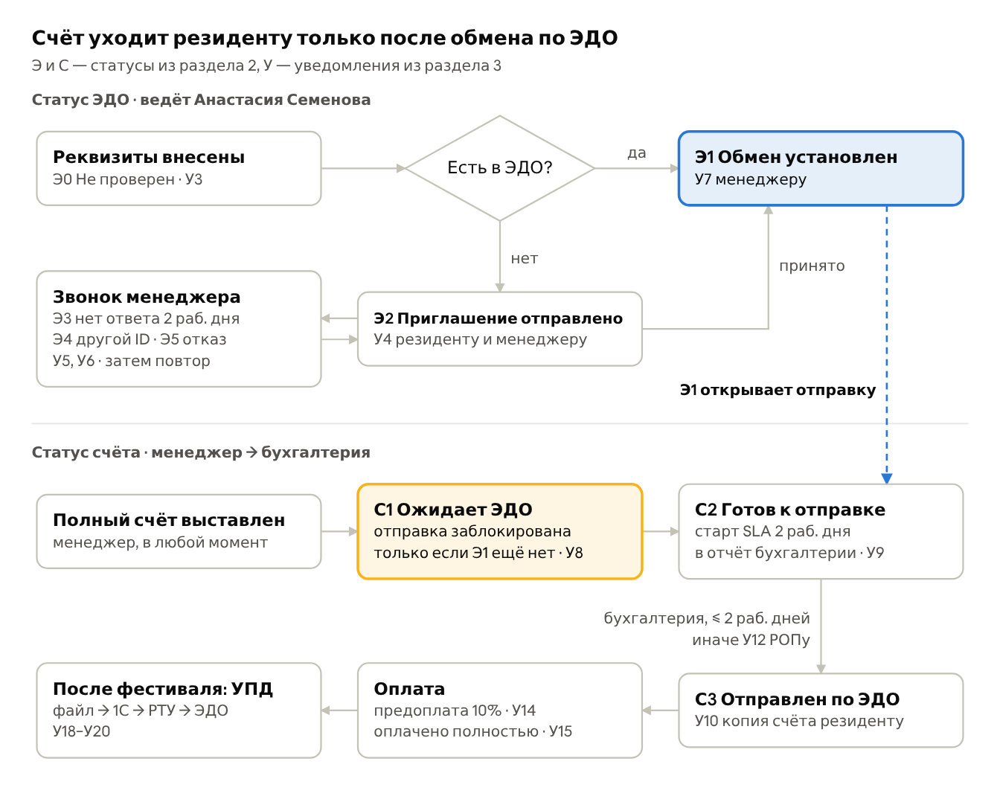

# ТЗ: автоуведомления ЭДО и счета + дашборд РОПа

10.11.2026 · Маргарита Жиганова

CRM должна сама сообщать каждому участнику процесса резидентов Пикника Афиши, что ему сделать сегодня: мгновенно — только по событиям, требующим реакции, остальное — в утреннем и вечернем отчёте на почту. Главное правило: счёт не может быть отправлен контрагенту, пока не произошёл обмен по ЭДО. Документ для отдела автоматизации CRM (Соня, Саша, Дима); GigaChat в нём не учитывается.

## 1. Роли и зоны ответственности

Уведомления адресуются ролям, а не фамилиям: смена сотрудника меняет только справочник получателей, без разработки.

| Роль | Кто | Отвечает за | Получает |
| --- | --- | --- | --- |
| Клиентский менеджер (продажи) | менеджеры МСК и СПб, в т.ч. Наташа | ведёт сделку до реквизитов; связывается с контрагентом, если приглашение в ЭДО не принято или настроен другой идентификатор | уведомления и отчёты только по своим сделкам |
| Менеджер по ЭДО, координатор | Анастасия Семенова | проверка контрагента в ЭДО, приглашения, статус ЭДО в карточке; блок проверки счетов и дублей | очередь ЭДО, дубли, ошибки идентификатора |
| Бухгалтерия | Марина Баранова (основной), Оксана Островская (замещение) | отправка счетов по ЭДО не позднее 2 рабочих дней; ежедневный мониторинг статусов ЭДО; пауза SLA | очередь счетов к отправке, ошибки ЭДО |
| Закрывающие документы (по схеме) | Александр / Марина — выгрузка в 1С; Ольга Захарова — РТУ и «Одобрено» | УПД после фестиваля | уведомления этапа УПД |
| Отдел продукта, автоматизация CRM | Соня, Саша, Дима | реализация статусов, триггеров, отчётов, дашборда | технические алерты о сбоях |
| Руководитель подразделения (РОП) | Маргарита Жиганова | регламент, контроль SLA, дашборд | сводки утром и вечером, эскалации |

## 2. Статусы в CRM и блокировка отправки счёта

В карточке сделки появляются два новых статуса — «Статус ЭДО» и «Статус счёта», — а отправка счёта технически заблокирована, пока статус ЭДО не «Обмен установлен». Каждый переход статуса пишется в журнал с датой, временем и автором: на нём стоят SLA, отчёты и дашборд.

**Статус ЭДО** (новое поле)

| Код | Статус | Кто ставит | Что дальше |
| --- | --- | --- | --- |
| Э0 | Не проверен | авто, когда менеджер сохранил реквизиты | Анастасия Семенова проверяет контрагента в ЭДО |
| Э1 | Обмен установлен | Анастасия Семенова или авто по ответу оператора ЭДО | счёт можно отправлять |
| Э2 | Приглашение отправлено | Анастасия Семенова | ждём принятия; идёт отсчёт 2 рабочих дня |
| Э3 | Не принято более 2 рабочих дней | авто из Э2 | клиентский менеджер связывается с контрагентом |
| Э4 | Настроен другой идентификатор | Анастасия Семенова | клиентский менеджер уточняет у контрагента ИНН / КПП / ID участника ЭДО |
| Э5 | Приглашение отклонено | Анастасия Семенова или авто | клиентский менеджер выясняет причину |

**Статус счёта** (новое поле; для каждого счёта сделки отдельно)

| Код | Статус | Условие перехода |
| --- | --- | --- |
| С0 | Черновик | счёт создан, не все данные заполнены |
| С1 | Ожидает ЭДО | полный счёт выставлен, статус ЭДО ≠ Э1; отправка заблокирована |
| С2 | Готов к отправке | полный счёт выставлен и статус ЭДО = Э1; стартует SLA 2 рабочих дня |
| С3 | Отправлен по ЭДО | бухгалтер отправил (кнопка или статус от оператора ЭДО) |
| С4 | Ошибка или отклонён в ЭДО | оператор вернул ошибку или контрагент отклонил |
| С5 | Аннулирован | дубль или ошибка, с обязательной причиной |

Статус оплаты остаётся как на схеме: Не оплачен → Предоплата 10% → Оплачено. Тип счёта: основной, допсчёт, доп. электрика (из калькулятора).

**Правило блокировки**

1. Кнопка и автоматика «Отправить счёт» недоступны, пока статус ЭДО ≠ «Обмен установлен». Подсказка на кнопке: «Счёт не может быть отправлен контрагенту, пока не произошёл обмен по ЭДО. Текущий статус: …».
2. Правило действует для всех типов счетов, включая автовыставление доп. электрики из калькулятора.
3. Автоотправка копии счёта резиденту на почту (есть на схеме) срабатывает только при переходе в С3, не раньше.
4. Ручного обхода блокировки нет. Контрагент без ЭДО вообще — открытый вопрос (раздел 13).

**Дополнительные поля карточки:** источник заявки (Опен Кола / почта / рассылка / вручную / калькулятор), код рассылки, ID участника ЭДО и оператор, дедлайн SLA (вычисляемый), пауза SLA (причина, с, по, кто поставил), признак «подозрение на дубль», способ отправки УПД (ЭДО / вручную).

## 3. Сетка мгновенных уведомлений

Мгновенно уходят только события, после которых кому-то нужно действовать сейчас; остальное собирается в утренний и вечерний отчёт (раздел 4). Канал по умолчанию — email; Telegram остаётся там, где он уже есть на схеме (оплаты). Уведомление бухгалтера «счёт можно отправлять» переводим из поштучных писем в очередь утреннего и вечернего отчёта.

| № | Событие (шаг схемы) | Кому | Канал и время | Суть сообщения | На схеме |
| --- | --- | --- | --- | --- | --- |
| У1 | Заявка пришла с Опен Кола или на почту | заявитель | автоответ в тот же канал, сразу | заявка получена, менеджер свяжется | да |
| У2 | Сделка попала в основную воронку, регион назначен (любой источник) | клиентский менеджер региона | email, сразу | новая заявка: резидент, источник, регион, ссылка на карточку | нет |
| У3 | Реквизиты внесены → Э0 «Не проверен» | Анастасия Семенова | утренний и вечерний отчёт | проверить контрагента в ЭДО, отправить приглашение | нет |
| У4 | Э2 «Приглашение отправлено» | резидент (контакт сделки), копия клиентскому менеджеру | email, сразу | вам отправлено приглашение в ЭДО от \[юрлицо\] через \[оператор\]; без него мы не сможем отправить счёт | нет |
| У5 | Э2 длится более 2 рабочих дней → авто Э3 | клиентский менеджер (Наташа) | email, сразу + в отчёт | свяжитесь с контрагентом: приглашение не принято N дней | нет, решение встречи |
| У6 | Э4 «Другой идентификатор» или Э5 «Отклонено» | клиентский менеджер, Анастасия Семенова | email, сразу | свяжитесь с контрагентом, уточните идентификатор или причину отказа | нет, решение встречи |
| У7 | Э1 «Обмен установлен» | клиентский менеджер | email, сразу | ЭДО подключено; если счёт уже выставлен — он в очереди бухгалтерии | нет |
| У8 | Полный счёт выставлен без ЭДО → С1 | клиентский менеджер | предупреждение в карточке при сохранении | счёт не может быть отправлен, пока нет обмена по ЭДО; текущий статус ЭДО | нет |
| У9 | С2 «Готов к отправке» | бухгалтерия | утренний и вечерний отчёт | строка в очереди с дедлайном SLA | да («счёт можно отправлять») |
| У10 | С3 «Отправлен по ЭДО» | клиентский менеджер; резидент | email, сразу | менеджеру: счёт № отправлен; резиденту: копия счёта (PDF), «счёт отправлен и ждёт оплаты» | да |
| У11 | С4 «Ошибка или отклонён в ЭДО» | бухгалтерия, Анастасия Семенова, клиентский менеджер | email, сразу | счёт не доставлен / отклонён, причина от оператора | нет |
| У12 | SLA нарушен: С2 после дедлайна, паузы нет | РОП, бухгалтерия, Анастасия Семенова | email в 18:00 дня дедлайна | список просроченных счетов; бухгалтер заполняет причину | нет |
| У13 | Поставлена пауза SLA (сбой или сдача отчётности) | РОП, клиентские менеджеры, Анастасия Семенова | email, сразу | отправка счетов приостановлена с … по …, причина … | нет |
| У14 | Предоплата 10% → статус «Предоплата» | клиентский менеджер | Telegram, сразу + в отчёт | поступила предоплата: резидент, сумма | да |
| У15 | Полная оплата → «Оплачено», карточка двигается дальше автоматически | клиентский менеджер | Telegram, сразу + в отчёт | оплата от резидента пришла | да |
| У16 | Допсчёт или доп. электрика (автосчёт из калькулятора) | как У8–У15 | как У8–У15 | та же цепочка, в теме пометка типа счёта | частично |
| У17 | Подозрение на дубль: у одного ИНН два и более неаннулированных счёта одного типа с одинаковой суммой или на одно место | Анастасия Семенова | утренний отчёт | список пар-дублей со ссылками; заменяет ручную выгрузку файла для проверки | нет (сейчас вручную) |
| У18 | После фестиваля CRM сформировала файл на УПД | Анастасия Семенова, клиентские менеджеры | email, сразу | проверить файл до \[дата\]; автосверка: оплатившие резиденты, не попавшие в файл | да, сверка новая |
| У19 | Файл УПД выгружен в 1С (отметка в CRM) | Ольга Захарова | email, сразу | выгрузить РТУ и поставить «Одобрено» | нет |
| У20 | УПД отправлен (ЭДО или вручную) | клиентский менеджер | в отчёт | УПД по резиденту отправлен, способ | да |
| У21 | Сбой: нет ответа от ЭДО или 1С, письмо не доставлено, отчёт не сформирован | Соня, Саша, Дима; копия РОПу | email, сразу | что сломалось, с какого времени, какие сделки затронуты | нет |

Напоминания резиденту об оплате раз в 2 дня делает GigaChat и в это ТЗ не входят.

## 4. Утренний и вечерний отчёты на почту

Каждый рабочий день CRM отправляет на почту два отчёта по статусам ЭДО и счетов: в 09:30 — «что сделать сегодня», в 18:30 — «что сделано и что осталось» (время московское, для МСК и СПб одинаково). Каждый получатель видит только свой срез. Отчёт уходит даже пустым («задач нет»), чтобы отсутствие письма само было сигналом сбоя.

| Получатель | Утро, 09:30 — что сделать | Вечер, 18:30 — итог дня |
| --- | --- | --- |
| Бухгалтерия (Марина Баранова, Оксана Островская) | счета «Готов к отправке» по сроку: сначала «срок сегодня», потом «завтра»; счета с ошибкой ЭДО; допсчета и электрика к отправке | отправлено сегодня (шт., ₽); осталось в очереди; нарушенные SLA с полем «причина»; активные паузы |
| Менеджер по ЭДО (Анастасия Семенова) | контрагенты «Не проверен»; приглашения без ответа (1 день / 2 дня / просрочено); «другой идентификатор» и «отклонено»; подозрения на дубли; сделки с ЭДО, где счёт не выставлен более 2 рабочих дней | принято приглашений за день; новые ошибки; итог по всем статусам ЭДО |
| Клиентский менеджер (свои сделки) | кому позвонить: приглашение не принято более 2 рабочих дней, другой идентификатор, отказ; «Предварительное согласие» без реквизитов более 2 рабочих дней; счета без оплаты более 5 рабочих дней; новые заявки без действий | что изменилось за день: принятые приглашения, отправленные счета, оплаты |
| РОП (Маргарита Жиганова) | сводка в цифрах по МСК и СПб: новые заявки за сутки, контрагенты по статусам ЭДО, очередь бухгалтерии и «срок сегодня», нарушения и паузы SLA, оплаты за вчера (шт., ₽); ссылка на дашборд | итог дня теми же цифрами + список эскалаций |

**Формат письма**

- Тема с цифрами, чтобы было понятно без открытия: «Пикник · Резиденты · Утро 10.11 · Бухгалтерия: 7 счетов к отправке, 2 — срок сегодня».
- Сверху 3–5 цифр, ниже таблицы по разделам. Строка: резидент, юрлицо и ИНН, регион, номер и сумма счёта, ответственный, дней в статусе, дедлайн, ссылка на карточку CRM.
- Цвет срока: зелёный — день 0, жёлтый — день 1, красный — день 2 и просрочка.
- Больше 30 строк — полный список добавляется вложением XLSX.
- Время и состав получателей меняет администратор CRM в настройках, без релиза.

## 5. Регламент по счетам (SLA)

Бухгалтерия отправляет счёт по ЭДО не позднее 2 рабочих дней после перехода в «Готов к отправке» и ежедневно мониторит статусы ЭДО. Исключения — сбой системы и сдача отчётности; они оформляются паузой в CRM, а не словами.

1. **Старт отсчёта** — момент перехода счёта в С2 «Готов к отправке» (полный счёт выставлен и обмен по ЭДО установлен). Счёт «Ожидает ЭДО» отсчёт не запускает.
2. **Дедлайн** — 18:00 по Москве второго рабочего дня после дня старта. Пример: счёт готов в понедельник в 15:00 → отправить до среды 18:00. Рабочие дни — по производственному календарю РФ.
3. **Ежедневно** по утреннему отчёту бухгалтер отправляет все доступные счета и проверяет статусы документов в ЭДО: доставлен, отклонён, ошибка. Ответственная — Марина Баранова, замещение — Оксана Островская.
4. **Исключения** — сбой системы (ЭДО, CRM, 1С) или сдача отчётности. Бухгалтер ставит «Паузу SLA»: причина, дата начала, плановая дата окончания. Периоды сдачи отчётности вносятся в календарь исключений заранее, на квартал вперёд.
5. **На время паузы** срок стоит; после неё отсчёт продолжается с того же места. Пауза видна в отчётах и на дашборде; РОП и клиентские менеджеры получают У13, чтобы предупредить резидентов.
6. **Нарушение** — срок прошёл, паузы нет: счёт красный в отчётах, эскалация РОПу (У12), бухгалтер заполняет причину в карточке.
7. **Приглашение в ЭДО** не принято за 2 рабочих дня или настроен другой идентификатор → клиентский менеджер (Наташа) связывается с контрагентом и отмечает результат в карточке.
8. **Главное правило не отменяется ничем:** без обмена по ЭДО счёт не отправляется ни по ЭДО, ни на почту.

## 6. Требования к реализации и приёмка уведомлений

Уведомления строятся на журнале переходов статусов и настраиваются без релиза: шаблоны, время и получатели меняются в настройках CRM.

- Часовой пояс Europe/Moscow для обоих регионов; производственный календарь РФ с праздниками и переносами.
- Журнал статусов: старое и новое значение, кто или какая автоматика изменила, дата и время.
- Шаблоны писем с переменными: {резидент}, {юрлицо}, {номер\_счёта}, {сумма}, {регион}, {менеджер}, {дедлайн}, {ссылка\_на\_карточку}.
- Получатели — по ролям и ответственному за сделку; замещение на время отпуска настраивается периодом.
- Одно событие — одно письмо получателю; повторное сохранение карточки не шлёт письмо заново.
- Журнал отправки: что, кому, когда, статус доставки. При ошибке — 3 повтора, затем алерт У21.
- Служебные уведомления сотрудникам отключить нельзя; письма резидентам о счёте и ЭДО идут как транзакционные, отдельно от маркетинговых рассылок.
- Интеграция CRM ↔ 1С ↔ ЭДО для УПД сейчас не работает (по схеме): до восстановления — поле «способ отправки УПД» и алерт У21 при расхождении.

**Критерии приёмки**

- [ ] Отправить счёт при статусе ЭДО ≠ «Обмен установлен» нельзя ни кнопкой, ни автоматикой — в том числе допсчёт и доп. электрику.
- [ ] Копия счёта резиденту на почту уходит только после «Отправлен по ЭДО».
- [ ] Утренний и вечерний отчёты приходят каждому получателю в рабочие дни в 09:30 и 18:30, в том числе пустые.
- [ ] Дедлайн SLA считается по производственному календарю; пауза останавливает и возобновляет отсчёт.
- [ ] Приглашение без ответа 2 рабочих дня само переходит в Э3 и попадает в отчёт клиентского менеджера.
- [ ] Каждая строка отчёта открывает карточку в CRM в один клик.
- [ ] Неделя теста на реальных сделках МСК и СПб без ручных правок статусов.

## 7. Схема статусов и точек уведомлений

Отправку открывает только переход в Э1: счёт, выставленный раньше, ждёт в С1, а после С2 у бухгалтерии 2 рабочих дня.

## 8. Дашборд РОПа: устройство и определения

Дашборд отвечает РОПу в реальном времени на три вопроса: сколько продано и сколько осталось; где застревают деньги (ЭДО, счета, оплаты); что приносит маркетинг. Верхний ряд плиток берём со схемы: новых заявок сегодня / всего лидов; продано мест МСК / СПб и сумма; свободных мест и сумма; в брони; отказов.

- **Обновление:** данные CRM — не реже раза в 5 минут; показатели рассылок — раз в час. На экране видно время последнего обновления.
- **Фильтры:** период (сегодня, 7 дней, с начала продаж, свой); город (Москва 26.06.2027, Санкт-Петербург 07.08.2027); площадка / фуд-корт; менеджер; источник заявки; сегмент резидента (резидент 2025, 2026, новый) и категория.
- **Доступ:** РОП — всё; клиентские менеджеры — свой срез; бухгалтерия и Анастасия Семенова — блоки «ЭДО и счета» и «Оплаты».
- **Клик по любой цифре** открывает список сделок за ней со ссылками на карточки; список выгружается в XLSX.

**Определения** (одинаковы для дашборда и отчётов)

| Термин | Что считаем |
| --- | --- |
| Лид | любая сделка в основной воронке |
| Бронь | место закреплено за резидентом (этап «Предварительное согласие» и дальше), оплаты ещё нет |
| Продано | поступила оплата (предоплата 10% или полная); на плитке отдельной строкой «из них оплачено полностью» — вариант, см. открытые вопросы |
| Свободно | ёмкость площадки − продано − бронь; сумма — по прайсу места |
| Отказ | сделка закрыта как отказ с обязательной причиной из справочника |
| Рабочий день | по производственному календарю РФ, московское время |

## 9. Метрики продаж и мест

Блок показывает выполнение плана по местам и деньгам и этап, на котором теряются сделки; всё — с разбивкой МСК / СПб.

| Метрика | Как считается | Вид |
| --- | --- | --- |
| Новые заявки | сделки, созданные за период; разрез по источнику | плитка + линия по дням |
| Всего лидов | все сделки в воронке на дату | плитка |
| Продано мест | места с поступившей оплатой; МСК / СПб | плитка |
| Сумма продаж | сумма счетов по проданным местам; отдельно фактически получено | плитка |
| Свободные места | ёмкость − продано − бронь; сумма по прайсу | плитка |
| Бронь | места с согласием без оплаты; отдельно бронь старше 5 рабочих дней без счёта | плитка + список |
| Отказы | число и распределение по причинам | плитка + столбцы |
| Выполнение плана | продано / план — по местам и по деньгам, по городам | прогресс-бар |
| Воронка | число сделок и конверсия между этапами: заявка → переговоры → согласие → реквизиты → ЭДО → счёт отправлен → оплата | воронка |
| Время в этапе | медиана рабочих дней на каждом этапе | столбцы |
| Сквозное время | медиана рабочих дней от заявки до оплаты | плитка |
| Средний чек резидента | оплаченная сумма / число оплативших резидентов | плитка |
| Доп. продажи | допсчета и доп. электрика: шт., ₽, доля резидентов | плитка |
| Резиденты в обоих городах | число резидентов с местами и в МСК, и в СПб | плитка |
| Загрузка площадок | продано / бронь / свободно по каждому фуд-корту и формату места | таблица с цветовой заливкой |

## 10. Метрики ЭДО, счетов, оплат и УПД

Блок показывает, сколько денег стоит на каждом шаге между согласием и оплатой, и соблюдается ли регламент 2 рабочих дней.

| Метрика | Как считается | Вид |
| --- | --- | --- |
| Контрагенты по статусам ЭДО | число в каждом статусе Э0–Э5 | столбцы |
| Время принятия приглашения | медиана рабочих дней от Э2 до Э1 | плитка |
| Принято за 2 рабочих дня | доля приглашений, принятых без звонка менеджера, % | плитка |
| Счета, заблокированные без ЭДО | счета С1: шт. и ₽ — деньги, которые стоят из-за ЭДО | плитка |
| Очередь бухгалтерии | счета С2: шт., ₽, из них «срок сегодня» | плитка |
| Соблюдение SLA | доля счетов, отправленных в срок, с учётом пауз, % | плитка + линия по неделям |
| Нарушения SLA | список с причинами и днями просрочки | таблица |
| Паузы SLA | рабочих дней на паузе за период по причинам (сбой / отчётность) | таблица |
| Ошибки и отклонения в ЭДО | счета С4 за период | плитка |
| Дебиторка | отправлено и не оплачено: 0–5, 6–10, более 10 рабочих дней после отправки, ₽ | столбцы |
| Поступления | оплаты по дням: предоплата / полная / допсчета | линия |
| Дубли счетов | найдено / аннулировано | плитка |
| УПД после фестиваля | сформировано → проверено → выгружено в 1С → РТУ одобрено → отправлено (ЭДО / вручную); оплатившие без УПД | воронка + список |

## 11. Маркетинг: CRM-рассылки и источники заявок

Маркетинговый блок показывает, сколько заявок и денег принесла каждая рассылка по базе и каждый источник. Для этого каждая сделка должна знать свой источник, а каждая рассылка — свой код.

**Что нужно для подсчёта**

- База из Excel загружается в CRM с сегментами: резидент 2025, резидент 2026, новый контакт; категория (ресторан, бар, фудтрак, мороженое, PopUp и т.д.).
- У каждой рассылки — код, адрес отправителя, вид (анонс, напоминание, инфоповод), сегмент.
- Во всех ссылках письма — UTM-метки: utm\_source=crm\_email, utm\_campaign=<код рассылки>, utm\_content=<сегмент>. Заявка с формы наследует их в поля «источник» и «код рассылки».
- Резидент ответил на письмо или позвонил — менеджер выбирает источник и код рассылки вручную; поле «источник» обязательно при создании сделки.

| Метрика | Как считается | Вид |
| --- | --- | --- |
| Размер базы | контакты всего и по сегментам; доля валидных email | плитка + столбцы |
| Доставляемость | доставлено / отправлено; жёсткие и мягкие отказы, % | по каждой рассылке |
| Открытия (open rate) | уникальные открытия / доставлено; справочно — завышается автозагрузкой картинок в почтовых клиентах | по каждой рассылке |
| Клики (CTR) | уникальные клики / доставлено, % | по каждой рассылке |
| CTOR | уникальные клики / уникальные открытия, % | по каждой рассылке |
| Отписки и жалобы | доля от доставленных, % | по каждой рассылке |
| Заявки с рассылки | сделки с источником «рассылка» и этим кодом | число |
| Конверсия в заявку | заявки / доставлено, % | по каждой рассылке |
| Конверсия в оплату | оплатившие / заявки с рассылки, % | по каждой рассылке |
| Выручка с рассылки | сумма оплат по сделкам с этим кодом, ₽ | по каждой рассылке |
| Возврат резидентов прошлых лет | доля резидентов 2025 и 2026, подавших заявку и оплативших в 2027, % | плитка |
| Источники заявок | заявки, оплаты и ₽ по источникам: Опен Кола, почта, рассылка, вручную, калькулятор | столбцы |

Итоговая таблица рассылок на дашборде: дата, код, сегмент, вид, тема, отправлено, доставлено %, open rate, CTR, заявки, оплаты, ₽ — новые сверху. Через 24 и 72 часа после отправки рассылки РОП получает на почту её строку из этой таблицы.

## 12. Срез по менеджерам, данные и приёмка дашборда

Таблица по клиентским менеджерам (строка на менеджера): лиды в работе и новые за период; конверсия заявка → оплата; продано мест и ₽; процент плана; время до первого контакта (если CRM фиксирует активности); просроченные действия — Э3 и Э4 без отметки о звонке, согласия без реквизитов.

**Данные, которые нужно начать собирать до запуска**

- Журнал переходов этапов и статусов с датой и временем (раздел 2).
- Справочник мест: город, фуд-корт, формат, размер, цена; связь «место ↔ сделка».
- План продаж по городам: места и ₽.
- Источник заявки и код рассылки (обязательные поля).
- Причина отказа из справочника.
- Тип счёта и статус оплаты по каждому счёту.
- Показатели рассылок из сервиса отправки (отправлено, доставлено, открытия, клики, отписки) по API или выгрузкой.

**Критерии приёмки дашборда**

- [ ] Цифры плиток совпадают с выгрузкой из CRM на одну дату — сверка по МСК и СПб.
- [ ] Клик по цифре открывает список сделок за ней.
- [ ] Фильтры город, менеджер, источник, период действуют на все блоки.
- [ ] Данные CRM обновляются не реже раза в 5 минут, рассылок — раз в час.
- [ ] Менеджер видит только свои сделки, бухгалтерия — только свои блоки.

## 13. Открытые вопросы

До старта разработки нужны ответы на эти вопросы; в скобках — вариант, заложенный в ТЗ.

- [ ] Есть ли интеграция CRM с оператором ЭДО, чтобы статусы приглашений и документов приходили сами? От этого зависит, какие триггеры автоматические, а какие по кнопке. (В ТЗ: оба варианта.)
- [ ] Кто отправляет приглашение в ЭДО — Анастасия Семенова или бухгалтерия? (Анастасия.)
- [ ] Что делать с контрагентом без ЭДО вообще: помочь подключиться, бумажный оборот или отказ? (Блокировка без исключений.)
- [ ] «Продано» — с предоплаты 10% или только после полной оплаты? (С предоплаты, полная — отдельной строкой.)
- [ ] Время отчётов и дедлайна SLA: 09:30, 18:30 и 18:00? Нужны ли отчёты в выходные в пиковые недели перед фестивалем?
- [ ] Telegram для оплат оставляем или переводим на почту, как всё остальное? (Оставляем, как на схеме.)
- [ ] Пороги в отчётах менеджера: счёт без оплаты 5 рабочих дней, бронь без счёта 5 рабочих дней — подходят?
- [ ] Через какой сервис идут CRM-рассылки и отдаёт ли он открытия и клики по API?
- [ ] Кто восстанавливает интеграцию CRM ↔ 1С ↔ ЭДО для УПД и к какому сроку — до первого фестиваля 26.06.2027?
- [ ] Александр из схемы (выгрузка в 1С) — это Саша из автоматизации или другой сотрудник? Нужно для справочника получателей.
